# Менеджер задач: REST API на FastAPI + PostgreSQL

Практическая работа № 2. Разработка REST API на FastAPI с использованием PostgreSQL, SQLAlchemy и Pydantic.

**Выполнила:** Ефимова Марина, группа Р4155

Сервис хранит пользователей и их задачи. Стек: FastAPI, асинхронная SQLAlchemy 2.0 (asyncpg), Pydantic v2 и pydantic-settings, миграции Alembic, PostgreSQL 16 в Docker.

## Структура проекта

```
.
├── app/
│   ├── __init__.py
│   ├── main.py             # создание приложения, middleware, подключение роутеров
│   ├── config.py           # настройки (pydantic-settings), DATABASE_URL из окружения
│   ├── db.py               # асинхронный движок, фабрика сессий, Base, get_session
│   ├── models.py           # ORM-модели User и Task (Mapped / mapped_column)
│   ├── schemas.py          # Pydantic-схемы *Create / *Read / *Update
│   └── routers/
│       ├── users.py
│       └── tasks.py
├── migrations/             # Alembic (шаблон async), первая миграция в versions/
├── docs/screenshots/       # скриншоты для отчёта
├── alembic.ini
├── docker-compose.yml
├── requirements.txt
├── .env.example
└── README.md
```

## Эндпоинты

| Метод  | Путь          | Описание                                                        | Коды ответа   |
|--------|---------------|-----------------------------------------------------------------|---------------|
| POST   | `/users`      | создать пользователя                                            | 201, 409, 422 |
| GET    | `/users/{id}` | получить пользователя                                           | 200, 404      |
| POST   | `/tasks`      | создать задачу                                                  | 201, 404, 422 |
| GET    | `/tasks`      | список задач: фильтры `done`, `owner_id`, пагинация `limit` (1–100), `offset` | 200, 422 |
| GET    | `/tasks/{id}` | получить задачу                                                 | 200, 404      |
| PATCH  | `/tasks/{id}` | частично обновить задачу                                        | 200, 404, 422 |
| DELETE | `/tasks/{id}` | удалить задачу                                                  | 204, 404      |

## Инструкция по запуску

Нужны Python 3.11+, Docker и Docker Compose.

```bash
# 1. Клонировать репозиторий
git clone https://github.com/bailaa/fastapi-task-manager.git
cd fastapi-task-manager

# 2. Запустить PostgreSQL и проверить, что база отвечает
docker compose up -d db
docker compose exec db psql -U app -d tasks -c "select 1"

# 3. Создать виртуальное окружение и установить зависимости
python3 -m venv .venv
source .venv/bin/activate        # Windows: .venv\Scripts\activate
pip install -r requirements.txt

# 4. Создать файл с настройками (строка подключения берётся из DATABASE_URL)
cp .env.example .env

# 5. Применить миграции (таблицы создаёт Alembic, а не create_all)
alembic upgrade head

# 6. Запустить сервис
uvicorn app.main:app --reload
```

Swagger UI: http://localhost:8000/docs

Проверить таблицы в базе:

```bash
docker compose exec db psql -U app -d tasks -c "\dt"
```

Как была создана миграция (повторять не нужно, она уже есть в `migrations/versions/`):

```bash
alembic init -t async migrations
alembic revision --autogenerate -m "create users and tasks"
alembic upgrade head
```

## Детали реализации

- **Конфигурация.** `app/config.py`: класс `Settings(BaseSettings)` читает `DATABASE_URL` из переменной окружения или из файла `.env`. Строки подключения в коде нет. Alembic берёт URL оттуда же (`migrations/env.py`), поэтому в `alembic.ini` поле `sqlalchemy.url` пустое.
- **База данных.** `app/db.py`: `create_async_engine`, `async_sessionmaker(expire_on_commit=False)` и зависимость `get_session`, которая отдаёт сессию через `yield` и закрывает её после ответа.
- **Модели.** Модели описаны через `Mapped` и `mapped_column`. Связь один-ко-многим задана через `relationship(back_populates=...)`. `email` уникальный (уникальный индекс), `title` — `String(200)`, `done` по умолчанию `false`, `created_at` проставляет база (`server_default=now()`). При удалении пользователя его задачи удаляются (`ondelete="CASCADE"`).
- **Схемы.** `UserCreate`, `UserRead`, `UserUpdate`, `TaskCreate`, `TaskRead`, `TaskUpdate`. Email валидируется через `EmailStr`, длина `title` — от 1 до 200 символов. В схемах `*Update` все поля необязательны. В `*Read` включено `from_attributes=True`. Для `title`, `done` и `owner_id` в `TaskUpdate` явный `null` запрещён: эти колонки `NOT NULL`, поэтому такой запрос получает 422, а не ошибку базы.
- **Роутеры.** Используется `APIRouter`, сессия приходит только через `Depends(get_session)`, ошибки возвращаются через `HTTPException`. PATCH обновляет только переданные поля: `model_dump(exclude_unset=True)`. Коды 404 и 409 описаны в `responses=`, поэтому они видны в Swagger.
- **Middleware.** `ProcessTimeMiddleware` (наследник Starlette `BaseHTTPMiddleware`) добавляет в ответ заголовок `X-Process-Time` и пишет в лог метод, путь, статус и время обработки:

```
2026-10-18 15:08:01,815 INFO app.requests: POST /users -> 201 (29.7 ms)
2026-10-18 15:08:02,686 INFO app.requests: POST /users -> 409 (4.3 ms)
2026-10-18 15:08:03,473 INFO app.requests: GET /users/1 -> 200 (4.1 ms)
```

## Скриншоты

### Swagger UI: список эндпоинтов

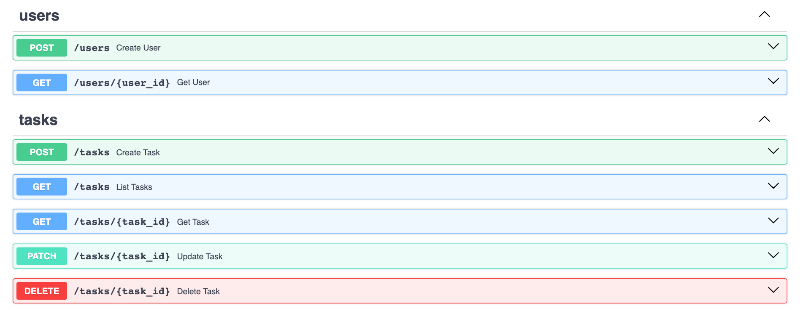

### Пользователи

POST `/users` — 201 Created:

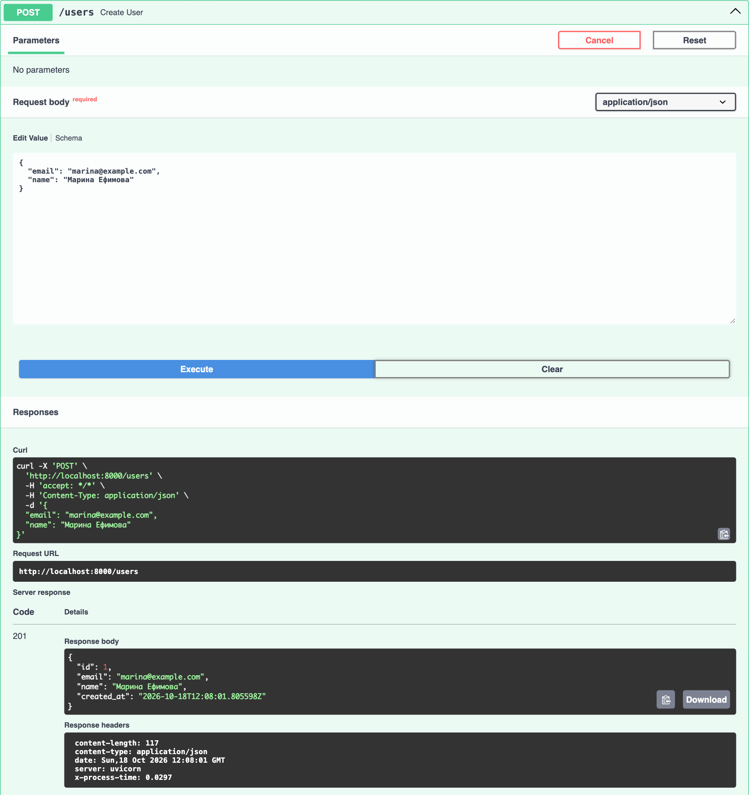

POST `/users` с занятым email — 409 Conflict:

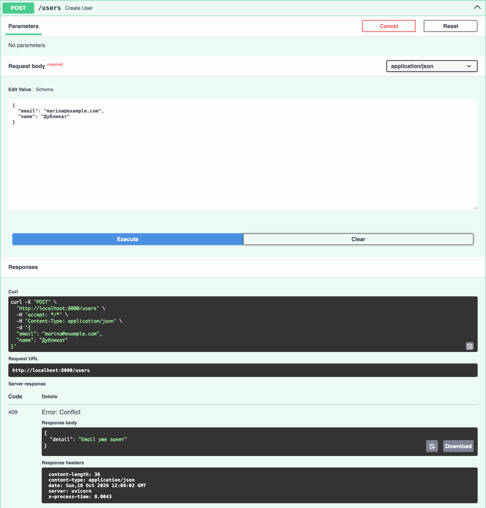

GET `/users/1` — 200 OK:

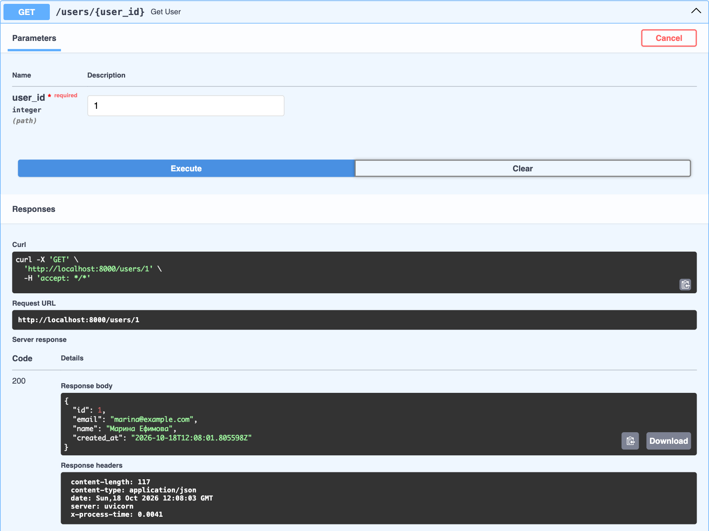

GET `/users/999` — **404 Not Found**:

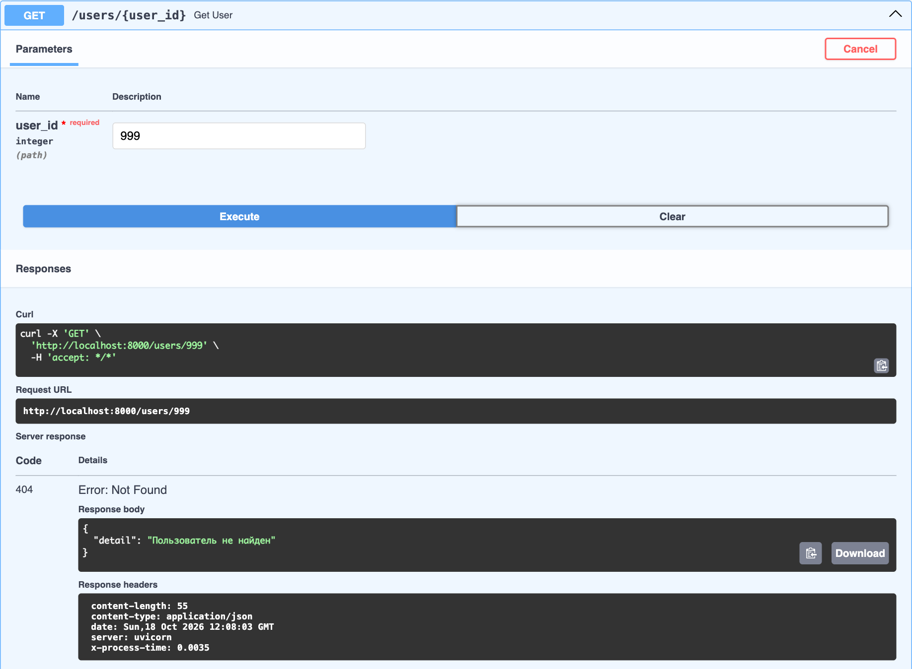

### Задачи

POST `/tasks` — 201 Created:

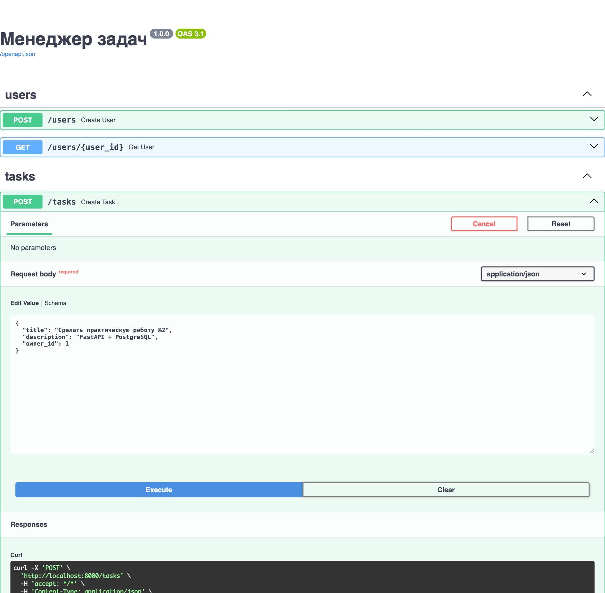

POST `/tasks`, вторая задача — 201 Created:

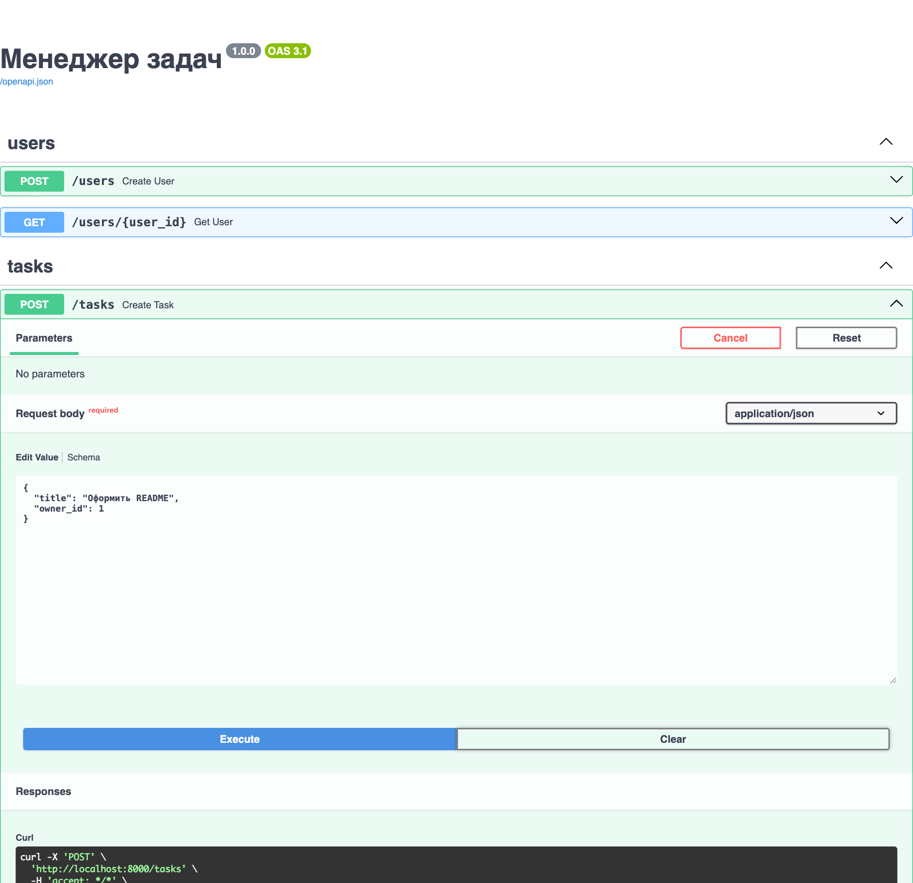

POST `/tasks` с несуществующим владельцем — **404 Not Found**:

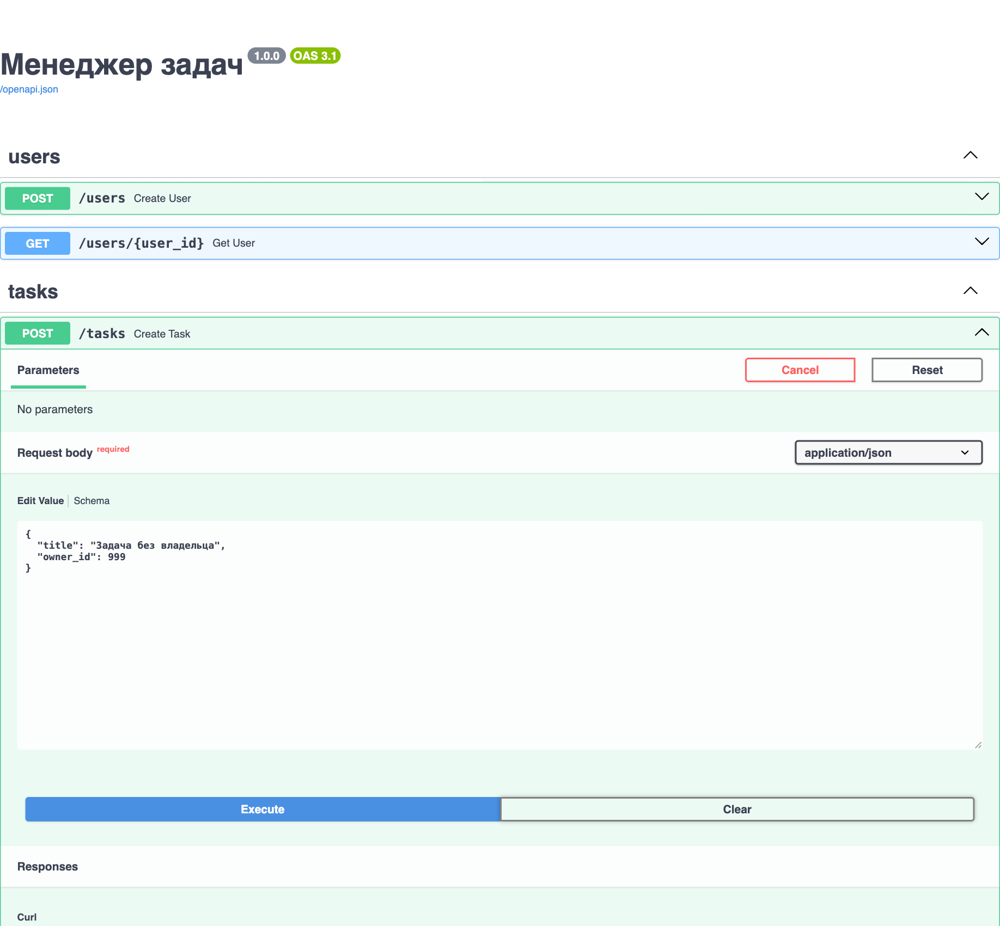

PATCH `/tasks/1` (`{"done": true}`) — 200 OK:

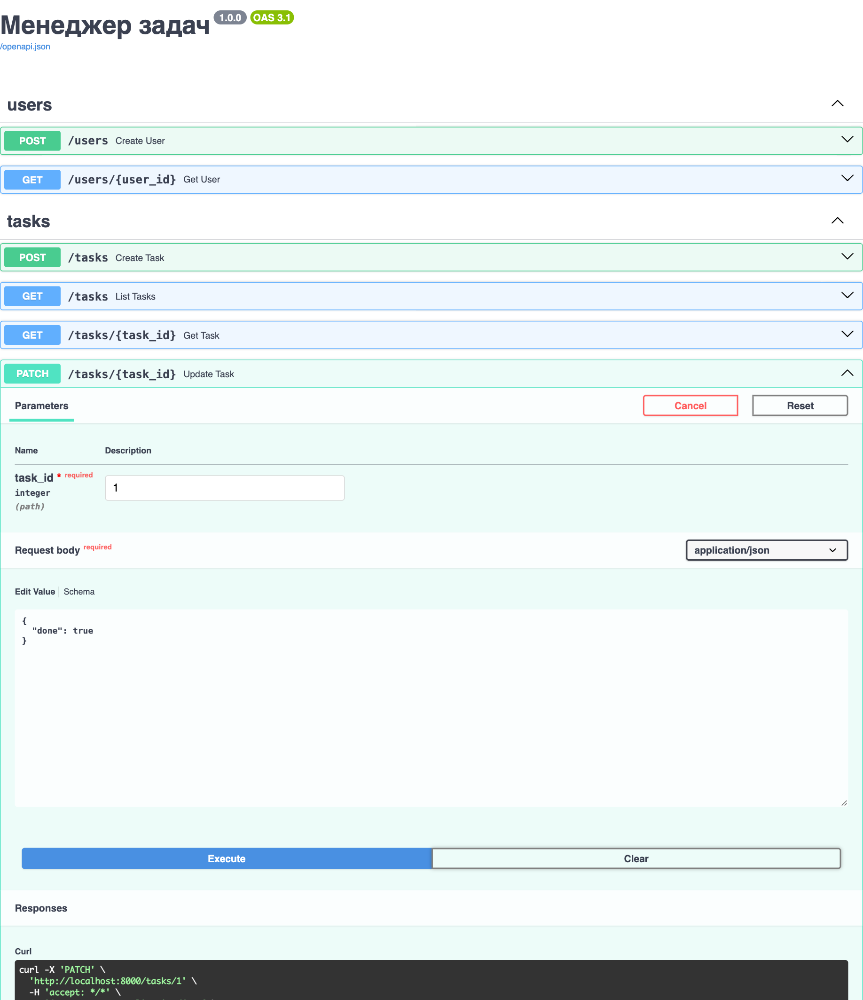

GET `/tasks?done=true&owner_id=1&limit=10&offset=0` — 200 OK:

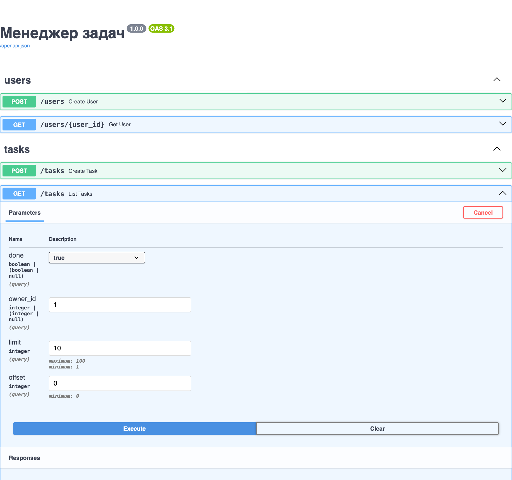

GET `/tasks/1` — 200 OK:

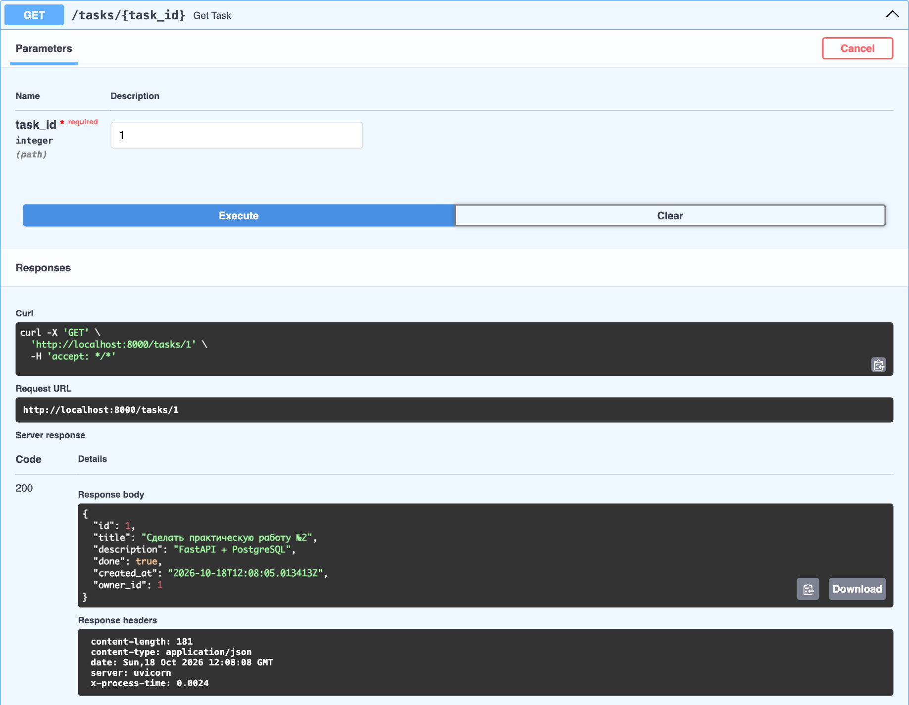

DELETE `/tasks/2` — 204 No Content:

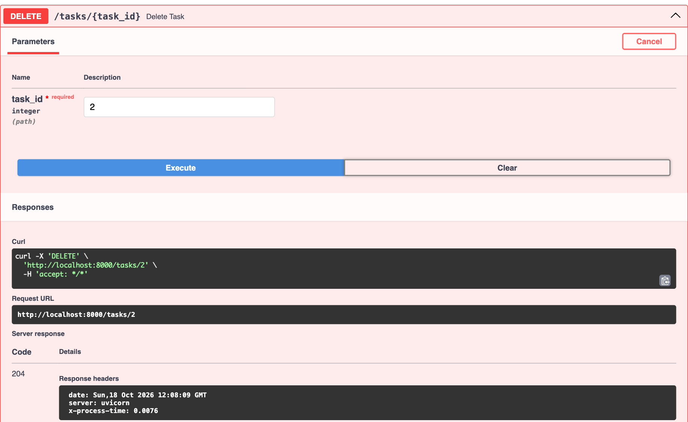

GET `/tasks/2` после удаления — **404 Not Found**:


### Таблицы в БД (`\dt` в psql)

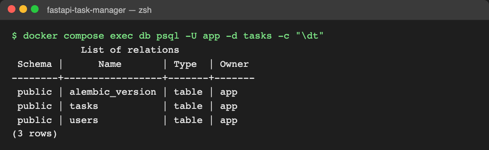

## Тестирование

Локально (нужен Python 3.12):

    pytest -q

Через Docker Compose:

    docker compose up -d db
    docker compose run --rm app pytest -q

## Контейнеры и образы

    docker compose up --build

- GHCR: `ghcr.io/bailaa/fastapi-task-manager:latest`
- Docker Hub: `<твой_username>/fastapi-task-manager:latest`

## CI/CD

GitHub Actions (`.github/workflows/ci.yml`): при push в `main` — тесты, затем сборка и публикация образа в GHCR и Docker Hub.

### Успешный pipeline


### Упавший pipeline (шаг 8)


## Ответы на контрольные вопросы

**1. Чем FastAPI отличается от Starlette и какие компоненты Starlette он использует?**

Starlette — лёгкий ASGI-фреймворк. В нём есть маршрутизация, запросы и ответы, middleware, WebSocket, фоновые задачи, статика и тестовый клиент, но нет валидации данных и автоматической документации. FastAPI построен поверх Starlette (класс `FastAPI` наследуется от `Starlette`) и добавляет:
- объявление параметров через аннотации типов;
- валидацию и сериализацию через Pydantic;
- систему зависимостей `Depends`;
- автоматическую генерацию OpenAPI-схемы и Swagger UI / ReDoc.

Из Starlette FastAPI берёт `Request` и `Response` (а также `JSONResponse` и другие), маршрутизацию, middleware (в этой работе — `BaseHTTPMiddleware`), `BackgroundTasks`, WebSocket, `StaticFiles` и `TestClient`. `HTTPException` из FastAPI — наследник одноимённого класса Starlette.

**2. Зачем разделять схемы Create, Read и Update?**

У каждой операции свой набор полей и свои правила:
- **Create** содержит только то, что присылает клиент. В нём нет `id` и `created_at`, их генерирует сервер. Обязательные поля в нём обязательны.
- **Read** описывает то, что сервер отдаёт: со служебными полями (`id`, `created_at`) и без того, что нельзя показывать (например, хэша пароля).
- **Update** нужен для частичного обновления, поэтому все поля в нём необязательны.

Если бы схема была одна, клиент мог бы прислать `id` или `created_at`, а через ответ могли бы утечь лишние данные. Кроме того, в Swagger документация каждой операции получается точной.

**3. Что делает `from_attributes=True`?**

Эта настройка разрешает Pydantic строить модель не только из словаря, но и из произвольного объекта: значения полей читаются из атрибутов (`obj.id`, `obj.title`). Благодаря ей ORM-объект SQLAlchemy можно напрямую вернуть из эндпоинта с `response_model=TaskRead` или вызвать `TaskRead.model_validate(task)`. В Pydantic v1 это называлось `orm_mode = True`.

**4. Почему сессия передаётся через `Depends`, а не создаётся глобально?**

`AsyncSession` не потокобезопасна и хранит состояние: кэш объектов (identity map) и текущую транзакцию. Одна глобальная сессия на все параллельные запросы смешала бы их транзакции и данные, а ошибка в одном запросе ломала бы остальные. Через `Depends(get_session)` каждый запрос получает свою сессию, и после ответа она гарантированно закрывается (код после `yield`), а соединение возвращается в пул. Кроме того, зависимость легко подменить в тестах через `app.dependency_overrides`, а в эндпоинтах нет глобального состояния.

**5. Чем `exclude_unset=True` отличается от `exclude_none=True`?**

- `exclude_unset=True` исключает поля, которые клиент **не передал** в запросе. Значения по умолчанию в результат не попадают.
- `exclude_none=True` исключает поля, у которых значение **равно `None`**, независимо от того, передал их клиент или нет.

Для PATCH нужен `exclude_unset`. Запрос `{"description": null}` означает «очистить описание»: с `exclude_unset` поле попадёт в изменения со значением `None`, а с `exclude_none` будет выброшено, и очистить описание станет невозможно. При этом поля, которые клиент не прислал, не перезапишутся значениями по умолчанию.

**6. Почему в production таблицы не создают через `create_all`?**

`Base.metadata.create_all()` только создаёт отсутствующие таблицы. Он не умеет изменять существующие: добавлять или переименовывать колонки, менять типы, индексы и ограничения. Схема в разных окружениях постепенно расходится, а история изменений нигде не хранится. Миграции (Alembic) решают эти проблемы:
- каждое изменение схемы — версионированный скрипт в git, который проходит код-ревью;
- изменения применяются одинаково на всех окружениях (`alembic upgrade head`), а таблица `alembic_version` показывает, какая версия схемы стоит в базе;
- изменение можно откатить (`downgrade`);
- в миграцию можно добавить перенос данных.

Кроме того, `create_all` при старте приложения выполнял бы DDL от каждого экземпляра сервиса, что опасно при нескольких репликах.
